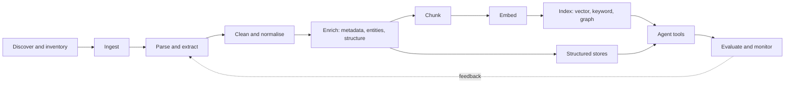

# Data Preparation for Process Optimization with Agentic Workflows

**Nimbus180 Engineering Knowledge Hub**

## 1. Purpose

Agentic workflows can analyse how a business process runs, find where it loses time or quality, and take over parts of its execution. How well they do this depends far less on the model than on the data the agents can reach. An agent that cannot find the current procedure, cannot tell which of three policy versions applies, or cannot query what actually happened to a case will produce confident, wrong recommendations.

This page describes how to prepare data for that purpose. It covers:

- what data process-optimization agents need, and where it lives
- how to treat structured process data (event logs, transactions)
- how to turn unstructured content (documents, email, tickets, transcripts) into something agents can use
- chunking, embeddings, and indexing
- how to expose prepared data to agents as tools
- governance, security, and evaluation

It is written for engineers and architects designing these pipelines. It assumes familiarity with LLMs and retrieval-augmented generation (RAG) at a conceptual level.

## 2. What process-optimization agents need

A process-optimization engagement moves through recognisable phases. Each needs different data.

| Phase | Question the agent answers | Data it needs |
|---|---|---|
| Discover | How does the process actually run? | Event logs, transaction records, case histories |
| Understand intent | How is it *supposed* to run? | SOPs, policies, process maps, work instructions, contracts, SLAs |
| Diagnose | Where and why does it deviate, stall, or loop? | Event logs joined with the reasons hidden in tickets, emails, notes, and call transcripts |
| Redesign | What should change? | All of the above, plus constraints: controls, regulations, system capabilities, roles |
| Execute | What should happen to this case now? | Current case state, applicable rules, reference data, tools to act |
| Monitor | Is the change working? | Fresh event data, KPIs, exceptions, feedback |

Four kinds of knowledge sit underneath this table:

| Kind | Description | Typical form | How agents should reach it |
|---|---|---|---|
| Process evidence | What happened: every case, step, and timestamp | Structured | Query tools (SQL, APIs, process-mining metrics) |
| Process intent | What should happen: procedures, rules, policies | Unstructured documents | Retrieval (search over indexed chunks) |
| Process context | Why things happened: explanations, complaints, exceptions | Unstructured text attached to cases | Extraction into structured fields, plus retrieval |
| Process structure | How things relate: steps, roles, systems, controls, KPIs | Scattered across all of the above | Knowledge graph or curated reference tables |

**The central design rule:** match the preparation method to the kind of knowledge. Numbers and events are queried, not embedded. Prose is retrieved. Relationships are modelled. Most failed projects embed everything into one vector store and expect the model to sort it out.

## 3. The preparation pipeline

| Stage | Output | Key decision |
|---|---|---|
| Discover and inventory | A catalogue of sources with owner, sensitivity, volume, and freshness | Which sources are authoritative for which process |
| Ingest | Raw copies with stable IDs and source metadata | Full load vs. incremental; how deletions propagate |
| Parse and extract | Text and structure (headings, tables, lists) from each format | Which parser per format; when OCR or a vision model is needed |
| Clean and normalise | De-duplicated, de-boilerplated, redacted content | What counts as a duplicate or a superseded version |
| Enrich | Metadata, entities, classifications, extracted fields | Which fields are worth extracting, and how they are validated |
| Chunk | Retrieval units with their context | Chunking strategy per document type |
| Embed | Vectors per chunk | Embedding model, dimensions, versioning |
| Index | Searchable stores | Vector, keyword, hybrid, graph, or a combination |
| Serve | Tools agents can call | Tool granularity, filters, citations, permissions |
| Evaluate and monitor | Metrics and regression tests | The golden set; what triggers re-indexing |

Keep the raw copy and every intermediate output. Chunking and embedding choices will change, and reprocessing from parsed text is far cheaper than re-ingesting and re-parsing.

## 4. Inventory before pipeline

Before building anything, list the sources and decide which ones matter. For each source record:

| Attribute | Why it matters |
|---|---|
| Owner and steward | Someone must confirm what is current and authorise access |
| Process and step it relates to | Lets agents filter retrieval to the process in question |
| Authority | Is this the official procedure or someone's working notes? |
| Format and volume | Drives parser choice and cost |
| Update frequency | Drives the refresh schedule |
| Sensitivity and access rules | Must be carried through to retrieval |
| Retention requirements | Determines what must be deleted, and when |
| Known quality problems | Duplicates, stale versions, scans, mixed languages |

Start with one process and the smallest set of sources that describes it well. A small, clean, authoritative corpus outperforms a large, noisy one, because retrieval precision drops as near-duplicate and contradictory content grows.

## 5. Structured process data

### 5.1 Event logs

Process analysis rests on the **event log**: one row per thing that happened to a case.

| Field | Required | Description |
|---|---|---|
| Case ID | Yes | Identifies one process instance (an order, a claim, a ticket) |
| Activity | Yes | What happened ("Invoice approved") |
| Timestamp | Yes | When it happened; ideally both start and end |
| Resource | Recommended | Who or what performed it (user, role, team, system) |
| Case attributes | Recommended | Properties of the case: customer segment, product, value, region, channel |
| Event attributes | Optional | Properties of the event: outcome, reason code, amount |

From an event log you can derive the process variants that actually occur, cycle and waiting times, rework loops, handoffs, and conformance against the intended model.

### 5.2 Common problems and fixes

| Problem | Effect | Fix |
|---|---|---|
| No single case ID across systems | The process appears fragmented | Build a correlation table linking IDs across systems (order → delivery → invoice) |
| Timestamps at day granularity | Step order within a day is unknowable | Use a secondary ordering key or the source system's sequence number; flag as approximate |
| Mixed time zones or local times | False waiting times, negative durations | Normalise to UTC at ingestion; keep the original zone |
| Batch-job timestamps | Many events appear simultaneous | Distinguish "recorded at" from "occurred at"; prefer the latter where available |
| Activity names that are status codes | Unreadable to analysts and agents | Maintain a mapping table from codes to business activity names |
| Too fine or too coarse granularity | Noise, or hidden steps | Define an activity hierarchy and aggregate to the level the question needs |
| Missing events (manual steps) | Invisible work, inflated waits | Infer from related artefacts (emails, notes) and mark as inferred |
| Duplicated events | Inflated rework counts | De-duplicate on case, activity, timestamp, and resource |
| Incomplete cases at extraction cut-off | Skewed duration statistics | Flag open cases and exclude them from end-to-end metrics |

### 5.3 How agents should use structured data

Do not embed tables or event rows. Embeddings cannot count, sum, sort, or compare, and an agent given fifty retrieved rows will not compute a median reliably. Instead:

- **Expose queries as tools.** Either a constrained SQL tool against a curated, read-only schema, or purpose-built functions such as `get_cycle_time(process, segment, period)` and `list_variants(process, top_n)`.
- **Pre-compute the metrics that matter.** Cycle time, waiting time per step, rework rate, first-time-right rate, and variant frequencies, sliced by the case attributes the business cares about. Agents reason better over a metric table than over raw events.
- **Describe the schema for the model.** A short data dictionary with table purposes, column meanings, units, allowed values, and join keys. This description is itself worth indexing so the agent can look it up.
- **Give stable identifiers.** Every result should carry case IDs so the agent can drill from a metric to the cases behind it, and from a case to its documents.

## 6. Unstructured data

Most of the explanation for *why* a process behaves as it does is unstructured: the procedure nobody follows, the email explaining why an approval took nine days, the ticket note that says "customer sent the wrong form again".

### 6.1 Source types

| Source | What it contributes | Particular difficulty |
|---|---|---|
| SOPs, work instructions, policies | Intended process, rules, controls | Multiple versions; stale copies; long documents |
| Process maps and diagrams | Structure and sequence | Content is visual; text extraction loses the flow |
| Contracts and SLAs | Obligations, deadlines, penalties | Dense legal language; clauses that reference each other |
| Email | Reasons, exceptions, informal workarounds | Quoted replies, signatures, disclaimers, attachments |
| Tickets and case notes | Root causes, customer friction | Terse, abbreviated, inconsistent |
| Chat and collaboration tools | How work really gets done | Fragmented threads, heavy context-dependence |
| Call and meeting transcripts | Customer voice, decision rationale | Transcription errors, no structure, speaker attribution |
| Scanned forms and PDFs | Inputs to the process | OCR quality, handwriting, layout |
| Spreadsheets | Shadow processes and trackers | Structure is implicit in layout; often really structured data |
| Wikis and intranets | Tribal knowledge | Navigation boilerplate; unknown authority |

### 6.2 Parsing and extraction

The goal of parsing is text that preserves the document's **structure**, because structure drives chunking and retrieval quality.

- **Convert to a structured intermediate format.** Markdown or a JSON document model, with headings, lists, tables, and reading order preserved. A numbered procedure flattened into a paragraph loses its meaning.
- **Use layout-aware extraction for PDFs and scans.** Plain text extraction scrambles multi-column layouts, headers and footers, and tables. Layout models and OCR services recover reading order and table cells.
- **Treat tables as tables.** Keep them intact as a unit, in a form that keeps row and column headers attached to values (Markdown or HTML). For large tables, consider loading them into a structured store instead.
- **Handle images and diagrams deliberately.** For process maps, generate a textual description with a vision-capable model ("Step 3, Credit check, is performed by Finance; if it fails, the flow returns to Step 1") and index that alongside a link to the original. Better still, extract the steps and transitions into structured form (see sections 7.2 and 10.3).
- **Thread emails and chats.** Reconstruct the conversation, strip quoted replies, signatures, and legal disclaimers, and keep sender, recipients, date, and subject as metadata. Process attachments as linked documents.
- **Segment transcripts.** Keep speaker labels and timestamps, split by topic or turn, and consider indexing an LLM-written summary per segment alongside the verbatim text.
- **Record extraction confidence.** Low-confidence OCR output should be flagged so that agents and evaluators can discount it.

### 6.3 Cleaning and normalisation

| Step | What to do | Why |
|---|---|---|
| Remove boilerplate | Strip navigation, headers, footers, cover pages, disclaimers | Boilerplate matches many queries and crowds out real content |
| De-duplicate | Exact duplicates by content hash; near-duplicates by similarity | Duplicates fill the retrieved set with one fact repeated |
| Resolve versions | Identify the current version; mark the rest as superseded with effective dates | Agents will otherwise cite outdated rules with full confidence |
| Normalise terminology | Maintain a glossary of abbreviations, system names, and synonyms | Lets queries match content that uses different words for the same thing |
| Detect language | Tag each document; decide whether to translate or use a multilingual model | Mixed-language corpora degrade monolingual embeddings |
| Redact sensitive data | Remove or mask personal and confidential data not needed for the task | Reduces exposure; often a legal requirement |
| Fix encoding and whitespace | Normalise Unicode, hyphenation, and line breaks | Prevents broken tokens and split words |

Version resolution deserves the most attention. For process work, *which rule applied at the time* matters as much as what the rule says now, so keep superseded versions but make their status and validity period explicit and filterable.

## 7. Enrichment: metadata and structure from text

Enrichment turns a pile of text into something that can be filtered, joined, and counted. It is the step that most improves agent accuracy, and the one most often skipped.

### 7.1 Metadata

Attach metadata to every document, and carry it down to every chunk.

| Field | Example | Used for |
|---|---|---|
| Source system and URI | SharePoint path, ticket ID | Citations; linking back to the original |
| Document type | SOP, policy, email, ticket, contract | Filtering; type-specific chunking |
| Process and step | Order-to-cash / Credit check | Scoping retrieval to the process under analysis |
| Owner / department | Finance Operations | Filtering; routing questions |
| Version, status, effective dates | v4, current, from 2026-03-01 | Excluding superseded content; point-in-time questions |
| Created / modified dates | | Freshness ranking |
| Sensitivity and access groups | Confidential; `finance-ops` | Security trimming at query time |
| Language | `en`, `es` | Model routing; filtering |
| Related case IDs | Order 48213 | Joining text to the event log |
| Section path | "4. Approvals > 4.2 Thresholds" | Chunk context; precise citations |

The link between unstructured content and **case IDs** is what makes diagnosis possible: it lets an agent move from "this variant takes nine days longer" to the notes and emails attached to cases in that variant.

### 7.2 Extracting structure from text

Much of the value in unstructured data for process optimization comes from converting it into structured fields that can then be counted and joined to the event log.

| Extraction | From | Enables |
|---|---|---|
| Reason / root-cause category | Ticket notes, emails, call summaries | "Why are cases delayed?" as a countable distribution |
| Exception type | Case notes | Frequency and cost of each exception path |
| Entities (customer, product, system, document type) | Any text | Joining to master data; filtering |
| Obligations and deadlines | Contracts, SLAs | Conformance checking against actual timings |
| Rules and thresholds | Policies, SOPs | Explicit business rules an agent can apply |
| Steps, roles, and handoffs | SOPs, process descriptions | The intended process model |
| Sentiment or friction signals | Customer communications | Prioritising improvements by customer impact |

Practices that keep extraction trustworthy:

- **Define a schema and a closed category list first.** Derive the categories from a sample with the business, then constrain the model to them plus an explicit "other / unclear" option. Open-ended labels cannot be aggregated.
- **Use structured output.** Have the model return JSON validated against a schema, and reject or retry on invalid output.
- **Keep the evidence.** Store the source span that supports each extracted value, so a reviewer or agent can verify it.
- **Measure before trusting.** Hand-label a few hundred items, measure precision and recall per field, and track them over time.
- **Sample for human review continuously,** concentrating on low-confidence items and the "other" category, which signals when the taxonomy needs revising.
- **Version the prompt and schema,** and record which version produced each value so results can be reprocessed.

## 8. Chunking

Embedding models and retrieval work on passages, not whole documents. A chunk is the unit that is embedded, retrieved, and placed in the agent's context. A chunk must be small enough to be specific and large enough to make sense alone.

### 8.1 Strategies

| Strategy | How it works | Good for | Weakness |
|---|---|---|---|
| Fixed size with overlap | Split every N tokens, repeating some tokens between neighbours | Uniform text; a quick baseline | Cuts across sentences, steps, and tables |
| Structure-aware (recursive) | Split on headings, then paragraphs, then sentences, down to a size limit | SOPs, policies, wikis, most business documents | Depends on parsing quality |
| Semantic | Split where the topic shifts, detected by embedding similarity between sentences | Transcripts and unstructured prose with no headings | More compute; less predictable sizes |
| Whole document | One chunk per document | Short items: tickets, emails, FAQs | Useless for long documents |
| Parent-child (small-to-big) | Embed small chunks for precise matching; return the larger parent section to the model | Procedures where a detail needs its surrounding context | More complex index and retrieval logic |
| Proposition-based | Use an LLM to rewrite content as self-contained factual statements, then embed those | Dense reference material, rules, contracts | Expensive; risk of rewriting errors |

Structure-aware chunking is the right default for process documentation. Add parent-child retrieval when answers need more context than the matching passage.

### 8.2 Guidelines

- **Never split a procedure mid-step, or a table mid-row.** Keep a numbered procedure together where it fits; where it does not, split between steps and repeat the procedure title and preceding step number in each part.
- **Make every chunk self-describing.** Prepend the document title and section path ("Credit Policy v4 > 4. Approvals > 4.2 Thresholds") to the chunk text before embedding. A chunk reading "the limit is 10,000 for this category" is unretrievable and unusable without it.
- **Consider generated context.** For corpora where chunks depend heavily on surrounding text, have an LLM write one or two sentences situating each chunk within its document, and prepend that before embedding and keyword indexing. This costs an LLM call per chunk but can reduce retrieval misses noticeably.
- **Start with a moderate size and tune by measurement.** A few hundred tokens with modest overlap is a reasonable starting point; adjust using the evaluation set in section 12 rather than by intuition.
- **Vary by document type.** A ticket is one chunk. A 60-page policy is many. A contract is chunked by clause.
- **Keep the mapping.** Every chunk carries its document ID, position, and section path, so results can be cited, expanded to neighbours, and deleted when the source changes.

## 9. Embeddings

### 9.1 What they are

An embedding model converts a piece of text into a vector of numbers (typically several hundred to a few thousand dimensions) such that texts with similar meaning produce vectors that are close together. Searching by vector distance finds passages that are *about* the same thing as the query, even when they share no words: "delayed payment authorisation" can match "invoice approval took too long".

### 9.2 What they are good and bad at

| Embeddings handle well | Embeddings handle poorly |
|---|---|
| Paraphrase and synonyms | Exact identifiers: order numbers, SKUs, error codes |
| Conceptual questions ("how do we handle disputed invoices?") | Numeric comparison and ranges ("orders over 10,000") |
| Cross-lingual matching (with multilingual models) | Negation ("cases that were *not* escalated") |
| Tolerance of typos and informal wording | Aggregation ("how many", "most common", "average") |
| Finding similar cases or similar complaints | Recency and validity ("the current policy") |
| | Rare internal jargon the model never saw |

The right-hand column is why embeddings are combined with keyword search, metadata filters, and structured queries (section 10), and never used alone.

### 9.3 Choosing a model

| Criterion | What to consider |
|---|---|
| Retrieval quality on your data | Public benchmarks are a starting point only; test candidates on your own evaluation set |
| Language coverage | Multilingual model if the corpus or the users are multilingual |
| Maximum input length | Must exceed your largest chunk; longer limits allow larger chunks |
| Dimensions | More dimensions cost more storage and memory; some models allow truncating vectors to a smaller size with modest quality loss |
| Query/document asymmetry | Some models expect different prefixes or task types for queries and documents; use them as documented |
| Cost and throughput | Initial embedding of a large corpus, plus re-embedding on every change |
| Hosting and data residency | Hosted API vs. self-hosted open model; where the text is sent and stored |
| Domain fit | Specialised vocabulary may justify a domain-tuned model, but try hybrid search and a glossary first |
| Modality | Multimodal embeddings if images or diagrams must be searched directly |

### 9.4 Operating rules

- **One model per index.** Queries and documents must be embedded by the same model and version. Vectors from different models are not comparable.
- **Record the model and version with every vector.** Changing the model means re-embedding the whole corpus; plan for it by building the new index alongside the old one and switching over after evaluation.
- **Embed the enriched chunk.** Include the title and section path (and generated context, if used) in the text sent to the model.
- **Cache by content hash.** Only re-embed chunks whose text changed. This makes incremental refresh cheap.
- **Batch and rate-limit.** Embedding is the bulk of the initial load time; batch requests and handle throttling with retries.
- **Estimate storage early.** Uncompressed, a vector takes roughly four bytes per dimension, so one million chunks at 1,536 dimensions is about 6 GB before index overhead. Vector quantisation reduces this substantially at a small quality cost.
- **Do not fine-tune first.** Better parsing, chunking, metadata, hybrid search, and reranking usually deliver more than a custom embedding model, at lower cost.

### 9.5 Other uses of embeddings in process work

Embeddings are useful beyond retrieval:

- **Clustering** free-text reasons, complaints, or ticket descriptions to discover categories before defining an extraction taxonomy.
- **Similar-case lookup** so an agent handling a case can see how comparable cases were resolved.
- **De-duplication** of near-identical documents and tickets.
- **Routing and classification** by similarity to labelled examples.
- **Drift detection** by tracking how the distribution of incoming requests shifts over time.

## 10. Indexing and retrieval

### 10.1 Stores and what they answer

| Question type | Example | Store |
|---|---|---|
| Conceptual | "How should a disputed invoice be handled?" | Vector + keyword (hybrid) index |
| Exact reference | "What does clause 7.3 say?" "Error E-4471" | Keyword index, metadata filter |
| Quantitative | "What is the median approval time by region?" | Relational / analytical store via query tool |
| Case-specific | "What happened to order 48213?" | Operational system or case store via API |
| Relational | "Which controls apply to steps performed by Finance in SAP?" | Knowledge graph |
| Global / thematic | "What are the main causes of rework?" | Extracted fields aggregated in a structured store; or summaries over clusters |

### 10.2 Hybrid search and reranking

- **Hybrid search** runs a vector query and a keyword (BM25) query together and fuses the results. It covers the weaknesses of each: vectors catch paraphrase, keywords catch identifiers and rare terms. Make it the default.
- **Metadata filters** narrow the search before ranking: process, document type, status = current, language, date range. Filtering on "current version only" removes the largest single source of wrong answers.
- **Reranking** takes the top results (say, 50) and re-scores them with a more accurate cross-encoder model, returning the best few. It improves precision considerably and lets the agent work with less context.
- **Security trimming** applies the user's access groups as a mandatory filter, so retrieval never returns content the requesting user could not open in the source system.
- **Result shape.** Return the chunk text, section path, source link, version, and dates, so the agent can cite and judge freshness.

### 10.3 Knowledge graphs for process structure

Processes are inherently relational: a process has steps, steps are performed by roles using systems, are governed by controls, consume and produce documents, and are measured by KPIs. A vector index cannot answer multi-hop questions over those relationships. A knowledge graph can.

A minimal process ontology:

| Entity | Example relationships |
|---|---|
| Process | `HAS_STEP` → Step; `OWNED_BY` → Role; `MEASURED_BY` → KPI |
| Step | `FOLLOWED_BY` → Step; `PERFORMED_BY` → Role; `USES` → System; `REQUIRES` → Document |
| Control / rule | `APPLIES_TO` → Step; `DEFINED_IN` → Policy section |
| Role | `BELONGS_TO` → Department |
| System | `PROVIDES` → Data entity |
| KPI | `DERIVED_FROM` → Event-log metric |

Guidance:

- **Populate it from authoritative sources first** (process models, system configuration, organisational data), then supplement with LLM extraction from SOPs, reviewed by a process owner.
- **Link graph nodes to chunks and to event-log activity names.** This is what lets an agent move from a slow step in the data, to the step in the model, to the rule and document that govern it.
- **Keep it small and curated.** A few hundred well-maintained nodes describing one process are more useful than an automatically generated graph of everything.
- **A graph database is optional at small scale.** A handful of relational reference tables can serve the same purpose.

## 11. Serving prepared data to agents

Prepared data reaches agents as **tools**. The design of those tools matters as much as the data behind them.

- **One tool per kind of question.** For example: `search_process_docs`, `get_case_history`, `query_process_metrics`, `find_similar_cases`, `get_process_model`. Clear, distinct tools are selected more reliably than one general "search everything" tool.
- **Expose filters as parameters.** Process, document type, date range, and status let the agent narrow its own search, and iterate when the first query misses.
- **Return compact, structured results.** IDs, titles, section paths, short text, source links, dates, and scores. Let the agent request the full document when it needs it, rather than returning everything up front.
- **Always return citations.** Recommendations about a business process must be traceable to a document section or a set of cases.
- **Describe tools precisely.** State what each returns, what it does not cover, and when to prefer another tool. The description is the agent's only guide.
- **Enforce permissions in the tool,** using the identity of the user the agent acts for, never a broad service identity.
- **Separate reading from acting.** Tools that change a system (update a case, send a message, trigger a workflow) need tighter scopes, validation, and human approval for consequential actions.
- **Budget context.** Retrieval that floods the context with marginal results degrades reasoning. Prefer fewer, reranked results; use subagents for large exploratory searches so only conclusions return to the main context.

The Model Context Protocol (MCP) is a practical way to package these tools so that several agents and clients can share them. See [Claude Code Skills, Subagents, MCP & Hooks](../../developer-tooling/claude-code/skills-vs-subagents.md).

## 12. Evaluation

Data preparation is only as good as what can be measured. Build the evaluation set before tuning anything.

### 12.1 The golden set

Assemble 50 to 200 realistic questions with the business, covering each question type in section 10.1. For each, record the expected answer and the documents, sections, or cases that support it. Include questions whose correct answer is "the documentation does not say", and questions where an outdated version would give a different answer.

### 12.2 What to measure

| Layer | Metric | Tells you |
|---|---|---|
| Parsing | Spot-check accuracy on tables, scans, and multi-column pages | Whether content survives extraction |
| Extraction | Precision and recall per field against hand labels | Whether derived structured data can be trusted |
| Retrieval | Recall@k, precision@k, MRR, nDCG | Whether the right chunks are found, and ranked high |
| Answer | Correctness, groundedness, citation accuracy | Whether the agent uses what it retrieved faithfully |
| Tool use | Right tool chosen; valid parameters; number of steps | Whether tools are well designed and described |
| Process outcome | Cycle time, rework rate, first-time-right, cost per case | Whether any of this improved the process |

Diagnose failures from the bottom up. When an answer is wrong, check whether the content was parsed correctly, then whether it was retrieved, and only then whether the model reasoned badly. Most failures are retrieval or data failures.

### 12.3 Ongoing

- Re-run the golden set on every change to parsing, chunking, the embedding model, or the index configuration.
- Monitor freshness: the lag between a source change and the index reflecting it.
- Log queries that returned nothing useful, and feed them back into the golden set and the content backlog. They often reveal missing documentation, which is itself a process finding.
- Review a sample of real agent sessions regularly with a process owner.

## 13. Governance, security, and risk

| Concern | Practice |
|---|---|
| Access control | Carry source permissions into the index and enforce them at query time. Never widen access by indexing. |
| Personal and confidential data | Minimise at ingestion; redact what the use case does not need; document the legal basis for what remains. |
| Retention and deletion | Propagate deletions from source to raw store, chunks, vectors, and extracted fields. Embeddings of personal data are still personal data. |
| Lineage | Every chunk, vector, and extracted value traces back to a source document, version, and pipeline run. |
| Data residency | Know where text is sent for parsing, embedding, and generation, and where vectors are stored. |
| Prompt injection | Ingested documents, emails, and tickets are untrusted input and may contain text written to manipulate an agent. Keep retrieved content clearly separated from instructions, limit what tools an agent holds while reading untrusted content, and require approval for consequential actions. |
| Authority and staleness | Mark authoritative sources; expire or flag content past its review date. |
| Auditability | Log which content was retrieved and cited for each agent recommendation or action. |
| Human oversight | Process changes proposed by agents are reviewed by the process owner before adoption. |

## 14. Reference implementation on Azure

One way to realise the pipeline on Azure. Each row lists common options, not requirements; verify current capabilities and regional availability before committing.

| Stage | Options |
|---|---|
| Raw and intermediate storage | Azure Blob Storage / Data Lake Storage; Microsoft Fabric OneLake |
| Orchestration | Azure Data Factory, Fabric pipelines, Azure Functions, Durable Functions |
| Parsing and OCR | Azure AI Document Intelligence; vision-capable models for diagrams |
| Enrichment and extraction | LLMs via Microsoft Foundry with structured output |
| Embeddings | Embedding models deployed through Microsoft Foundry / Azure OpenAI |
| Vector, keyword, and hybrid search | Azure AI Search (hybrid queries, semantic ranking, security filters) |
| Vectors alongside operational data | Azure Cosmos DB; Azure Database for PostgreSQL with `pgvector`; Azure SQL |
| Event logs and metrics | Fabric / Synapse warehouse, Azure SQL, Azure Data Explorer |
| Knowledge graph | Cosmos DB for Apache Gremlin, PostgreSQL with a graph extension, or relational reference tables |
| Agent tools | MCP servers hosted on Azure Functions or Container Apps |
| Governance | Microsoft Purview (catalogue, classification, lineage); Microsoft Entra ID for identity and group-based trimming |
| Monitoring | Application Insights; Foundry evaluation tooling |

## 15. Common pitfalls

| Pitfall | Consequence | Instead |
|---|---|---|
| Embedding everything into one vector store | Agents cannot count, compare, or join | Route each kind of knowledge to the right store |
| Indexing every version of every document | Confident answers from superseded rules | Resolve versions; filter to current by default |
| Fixed-size chunking of procedures and tables | Steps and values separated from their meaning | Structure-aware chunking with section context |
| Chunks without titles or section paths | Unretrievable, uncitable fragments | Prepend context to every chunk |
| Vector search only | Missed identifiers, codes, and rare terms | Hybrid search with reranking |
| No link between documents and cases | Diagnosis stops at "what", never reaches "why" | Extract and store case IDs as metadata |
| Free-form LLM labels | Categories that cannot be aggregated | Closed taxonomy with schema-validated output |
| Tuning by intuition | Changes that help one question and hurt ten | Golden set and regression runs |
| One service identity for retrieval | Users see content they should not | Per-user security trimming |
| Treating ingestion as a one-off | Index drifts from reality within weeks | Incremental refresh with deletion propagation |
| Starting with the whole enterprise | Months of pipeline work before any insight | One process, a small authoritative corpus, then expand |

## 16. Readiness checklist

- [ ] Target process and success metrics agreed with the process owner
- [ ] Source inventory complete, with owners, authority, and sensitivity recorded
- [ ] Event log built, with case correlation across systems and timestamps normalised
- [ ] Core process metrics pre-computed and exposed through a query tool
- [ ] Parsers chosen per format; tables and scans spot-checked
- [ ] Duplicates removed; versions resolved; current status filterable
- [ ] Metadata schema defined and applied to every document and chunk
- [ ] Case IDs linked between unstructured content and the event log
- [ ] Extraction taxonomy defined with the business; accuracy measured on a labelled sample
- [ ] Chunking strategy chosen per document type; chunks carry title and section path
- [ ] Embedding model selected by testing on own data; model and version recorded with vectors
- [ ] Hybrid search, metadata filters, and reranking configured
- [ ] Process structure captured in a graph or reference tables
- [ ] Agent tools defined with clear descriptions, filters, and citations
- [ ] Permissions enforced at query time with the user's identity
- [ ] Golden set built; baseline metrics recorded
- [ ] Incremental refresh and deletion propagation working
- [ ] Logging, lineage, and human review in place

## Related

- [Claude Code Skills, Subagents, MCP & Hooks](../../developer-tooling/claude-code/skills-vs-subagents.md)
- [AI-Assisted Development with VS Code, Claude Code & GitHub Copilot](../../developer-tooling/vscode/claude-code-copilot-guide.md)
