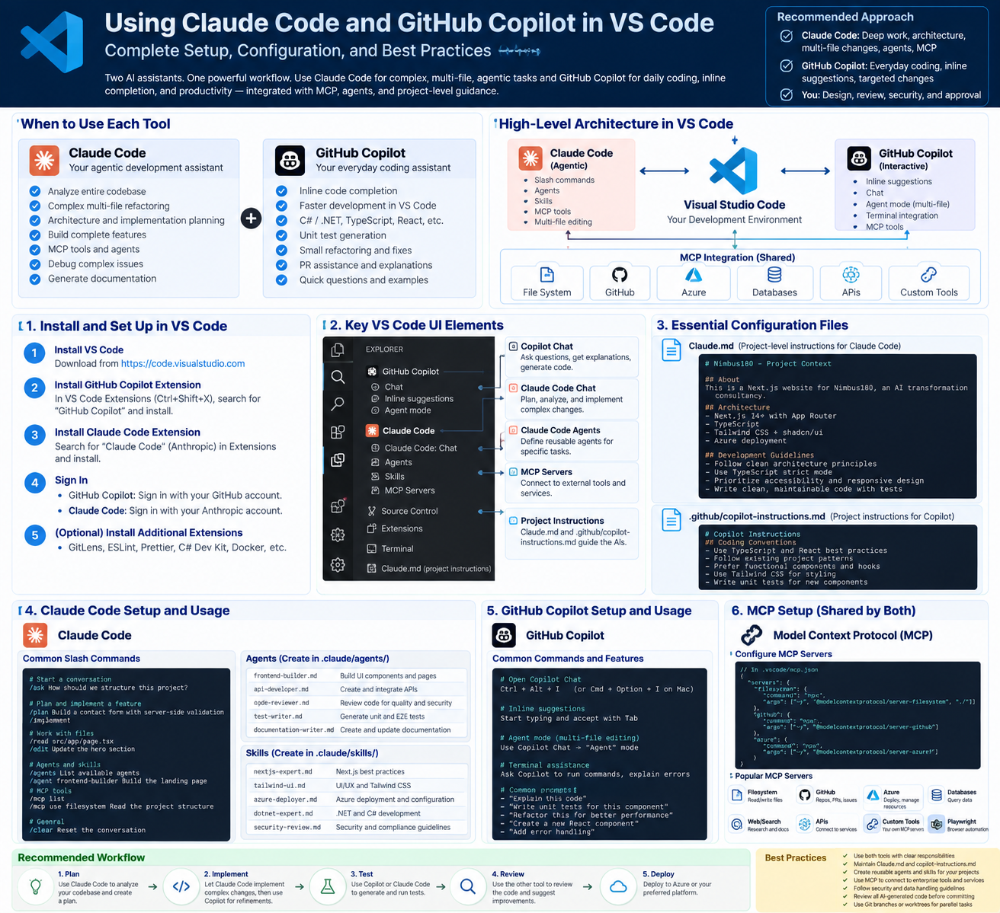

# AI-Assisted Development with VS Code, Claude Code & GitHub Copilot

**Nimbus180 Engineering Knowledge Hub**

*Engineering Playbook | Version 1.0*

## 1. Purpose

This guide establishes a consistent, secure, and maintainable AI-assisted software development environment using Visual Studio Code, Claude Code, GitHub Copilot, and Azure tooling.

The goal is to accelerate software delivery while preserving sound architectural decisions, code quality, security, and engineering ownership.

The recommended model is:

**Human Architect → AI-Assisted Implementation → Automated Validation → Human Approval**

AI assistants accelerate implementation. They do not replace architectural governance, deterministic testing, security controls, or engineering accountability.

### Reference Architecture



*Figure 1. Recommended VS Code development stack with Claude Code, GitHub Copilot, skills, agents, and MCP.*

---

## 2. Recommended Technology Stack

| Layer | Recommended technology | Responsibility |
|---|---|---|
| IDE | Visual Studio Code | Primary engineering workspace |
| Primary agent | Claude Code | Repository analysis, complex implementation, refactoring |
| Coding assistant | GitHub Copilot | Inline completion, coding assistance, agent mode |
| Azure assistant | GitHub Copilot for Azure | Azure-focused development and operations |
| Source control | Git + GitHub | Version control and collaboration |
| Frontend | Next.js, React, TypeScript | Web applications |
| Backend | ASP.NET Core | APIs and business services |
| AI platform | Microsoft Foundry | AI application development |
| Tool integration | MCP | Standardized tool exposure |
| Testing | xUnit, Playwright | Automated quality assurance |
| Deployment | GitHub Actions, Azure | CI/CD and hosting |

### Engineering principle

Use the simplest tool that can reliably complete the task. Avoid unnecessary overlap between AI agents.

---

## 3. Installation and Verification

### 3.1 Visual Studio Code

Install VS Code from:

https://code.visualstudio.com/

Verify installation:

```powershell
code --version
```

### 3.2 GitHub Copilot

Install from the VS Code Extensions Marketplace or run:

```powershell
code --install-extension GitHub.copilot
```

Sign in using your GitHub account.

Verify installed extensions:

```powershell
code --list-extensions --show-versions |
    Select-String "copilot"
```

Open Copilot Chat:

`Ctrl + Alt + I`

### 3.3 Claude Code

Install Claude Code using the official installation instructions:

https://code.claude.com/docs/en/overview

Verify:

```powershell
claude --version
```

Launch Claude Code from your project directory:

```powershell
cd C:\ai\my-project
claude
```

Claude Code can also be used through its VS Code integration.

### 3.4 GitHub Copilot for Azure

Install:

```powershell
code --install-extension ms-azuretools.vscode-azure-github-copilot
```

Sign in to Azure and verify that your account has the required permissions.

### 3.5 Additional recommended extensions

- C# Dev Kit
- ESLint
- Prettier
- Playwright Test for VS Code
- Docker
- Bicep
- GitHub Pull Requests and Issues
- GitLens
- markdownlint

Install only extensions that are needed for your project.

---

## 4. Claude Code vs. GitHub Copilot

| Activity | Preferred assistant |
|---|---|
| Architecture exploration | Claude Code |
| Complex multi-file implementation | Claude Code |
| Repository understanding | Claude Code |
| Inline code completion | GitHub Copilot |
| Small coding improvements | GitHub Copilot |
| Unit test generation | Either |
| Code review | Copilot or an independent Claude review |
| Azure resource guidance | Copilot for Azure |
| MCP server implementation | Either |
| Website scaffolding | Claude Code |
| PR management | GitHub tooling |

These are preferred workflows, not exclusive capabilities.

**Rule:** Assign one primary agent to each implementation task. Avoid concurrent modifications to the same files.

---

## 5. Repository Configuration

Recommended project structure:

```text
my-project/
├── CLAUDE.md
├── .claude/
│   ├── settings.json
│   ├── agents/
│   │   ├── architect.md
│   │   └── code-reviewer.md
│   └── skills/
│       ├── api-development/
│       │   └── SKILL.md
│       └── security-review/
│           └── SKILL.md
├── .github/
│   ├── copilot-instructions.md
│   ├── instructions/
│   └── workflows/
├── docs/
│   ├── architecture/
│   └── adr/
├── src/
└── tests/
```

The configuration should be version-controlled and reviewed like application code.

---

## 6. CLAUDE.md — Project Instructions

`CLAUDE.md` provides persistent project-level instructions to Claude Code.

It should define engineering conventions, architectural constraints, testing requirements, and development expectations.

### Recommended template

```markdown
# Project Engineering Instructions

## Role
Act as a Principal Software Engineer and
Solutions Architect.

## Architecture
- Follow SOLID and separation of concerns.
- Prefer maintainable, testable solutions.
- Keep business logic independent of infrastructure.
- Avoid unnecessary abstractions.
- Use dependency injection.
- Apply domain-driven design where justified.

## Development Workflow
1. Inspect the existing implementation.
2. Understand the requirements.
3. Propose a plan for complex changes.
4. Implement focused changes.
5. Add or update tests.
6. Run relevant validation.
7. Summarize changes and risks.

## Security
- Never commit credentials.
- Validate inputs and authorization.
- Apply least privilege.
- Do not log sensitive information.
- Do not expose internal services unnecessarily.

## Quality
- Use structured logging.
- Handle failures explicitly.
- Make retryable write operations idempotent.
- Follow repository naming conventions.
- Do not claim tests passed unless executed.

## AI Development
- Use approved tools only.
- Validate tool inputs and outputs.
- Keep business rules outside LLM prompts.
- Require approval for sensitive operations.
```

### Best practices

Keep `CLAUDE.md` concise. Move specialized instructions into skills or referenced documentation.

Do not use it as a dumping ground for every project detail.

---

## 7. GitHub Copilot Instructions

Copilot supports repository-level instructions through:

`.github/copilot-instructions.md`

Example:

```markdown
# Copilot Engineering Instructions

- Follow the project's existing architecture.
- Use TypeScript strict typing.
- Prefer reusable components.
- Write unit tests for business logic.
- Avoid introducing unnecessary dependencies.
- Do not hardcode credentials.
- Use existing logging and error handling patterns.
- Preserve API backward compatibility.
```

### Shared standards

Claude Code and Copilot should follow the same architectural standards.

Maintain a common engineering standards document and reference or synchronize the applicable rules into each assistant's supported instruction format.

Do not assume Copilot automatically reads `CLAUDE.md` or that Claude automatically reads Copilot instructions.

---

## 8. Claude Skills

A skill is a reusable package of instructions for a specialized task.

Examples:

- API development
- Security review
- MCP server implementation
- Next.js development
- Architecture decision records
- Automated testing

### Example structure

```text
.claude/
└── skills/
    └── api-development/
        └── SKILL.md
```

### Example SKILL.md

```markdown
---
name: api-development
description: Design and implement maintainable ASP.NET Core APIs.
---

# API Development

When implementing an API:

1. Review existing API conventions.
2. Define request and response contracts.
3. Separate endpoint, application and domain logic.
4. Validate inputs and authorization.
5. Use dependency injection.
6. Handle errors consistently.
7. Add unit and integration tests.
8. Document API contracts.
```

Skills should be narrow, reusable, and outcome-oriented.

**Important:** Skills are instructions, not a substitute for executable code or automated validation.

---

## 9. Claude Subagents

Subagents are specialized AI assistants configured for particular responsibilities.

Suggested subagents:

| Agent | Responsibility |
|---|---|
| Solution Architect | Design and architectural analysis |
| Backend Engineer | API and service implementation |
| Frontend Engineer | UI and web application development |
| Security Reviewer | Security and authorization review |
| Test Engineer | Automated test planning and implementation |
| Code Reviewer | Independent code review |

### Example

`.claude/agents/code-reviewer.md`

```markdown
---
name: code-reviewer
description: Review code for defects, security risks, and maintainability.
tools: Read, Grep, Glob
---

You are a senior software engineer.

Review the changes for:
- Correctness
- Security vulnerabilities
- Architecture violations
- Error handling
- Test coverage
- Maintainability

Do not modify files.

Report findings by severity and include
file references and actionable recommendations.
```

Tool availability and agent configuration syntax should be checked against the installed Claude Code version.

Use restricted tool permissions for review-only agents.

### Skills vs. subagents

For a side-by-side comparison, see [Claude Code Skills vs. Subagents](../claude-code/skills-vs-subagents.md).

---

## 10. Model Context Protocol (MCP)

MCP standardizes how AI applications connect to external tools, resources, and prompts.

Conceptual architecture:

```text
Claude Code / Compatible AI Client
              |
          MCP Client
              |
          MCP Server
              |
      Business Capabilities
              |
        APIs / Services
```

An MCP server can expose multiple tools.

Example:

```text
Claims MCP Server
├── get_claim
├── get_policy
├── get_claim_documents
└── get_adjudication_results
```

### MCP configuration principles

1. Register only trusted MCP servers.
2. Apply least-privilege access.
3. Separate development and production credentials.
4. Validate tool arguments.
5. Require approval for sensitive actions.
6. Audit tool execution.
7. Protect secrets using approved credential stores.

### Example command

Claude Code supports MCP management commands such as:

```powershell
claude mcp list
```

To inspect MCP configuration options:

```powershell
claude mcp --help
```

For an illustrative local HTTP MCP server:

```powershell
claude mcp add --transport http claims-tools http://localhost:3000/mcp
```

This assumes a compatible MCP server is already running at that endpoint.

Never connect an untrusted MCP server to production credentials.

---

## 11. Useful Claude Code Commands

| Command | Purpose |
|---|---|
| `claude` | Start an interactive session |
| `claude --version` | Display installed version |
| `claude --help` | Show CLI options |
| `claude mcp list` | List configured MCP servers |
| `claude mcp --help` | Show MCP management commands |
| `/help` | Show interactive commands |
| `/init` | Initialize project guidance |
| `/memory` | Inspect or manage Claude memory files |
| `/agents` | Manage available subagents |
| `/mcp` | Inspect MCP connections |

Slash-command availability may vary by Claude Code version.

---

## 12. Recommended Development Workflow

### Phase 1 — Understand

Use Claude Code to inspect the repository, architecture, dependencies, and requirements.

Deliverable: implementation plan.

### Phase 2 — Design

Define:

- Application boundaries
- API contracts
- Data flows
- Security controls
- Error handling
- Testing strategy

Record significant decisions in ADRs.

### Phase 3 — Implement

Use Claude Code for larger coordinated changes and Copilot for targeted development.

Keep changes focused and reviewable.

### Phase 4 — Validate

Run:

- Build and lint checks
- Unit tests
- Integration tests
- Security scanning
- Dependency checks
- Browser tests where applicable

### Phase 5 — Review

Use an independent AI review as an additional quality signal.

Review findings manually.

AI review does not replace engineering approval.

### Phase 6 — Deploy

Use approved CI/CD pipelines with environment-specific configuration and secrets management.

---

## 13. Website Development Workflow

For Nimbus180 websites:

**Preferred stack**

- Next.js
- React
- TypeScript
- Tailwind CSS
- shadcn/ui
- Playwright
- GitHub Actions
- Azure hosting

Recommended sequence:

1. Define requirements and visual references.
2. Create application architecture.
3. Build the design system.
4. Implement page layouts and navigation.
5. Implement reusable components.
6. Add content and SEO metadata.
7. Validate responsiveness and accessibility.
8. Run automated tests.
9. Review changes.
10. Deploy through CI/CD.

Use Claude Code as the primary builder and Copilot for daily refinements.

---

## 14. .NET and Azure Development Workflow

For enterprise backend applications:

**Preferred stack**

- ASP.NET Core
- C#
- Azure App Service or AKS
- Azure Key Vault
- Managed Identity
- Application Insights
- OpenTelemetry
- GitHub Actions or approved enterprise pipelines

Architectural standards:

- Separate API, application, domain, and infrastructure concerns.
- Use explicit contracts and validation.
- Prefer managed identity over embedded credentials.
- Implement correlation IDs and distributed tracing.
- Use resilient outbound integrations.
- Apply idempotency for retryable operations.
- Keep business rules deterministic.
- Document important decisions.

For AI-enabled applications, expose approved business capabilities through carefully scoped tools rather than giving agents unrestricted access to underlying APIs.

---

## 15. Troubleshooting

| Problem | What to check |
|---|---|
| Copilot not responding | GitHub authentication, entitlement, extension status |
| No inline suggestions | Editor settings, file type, extension state |
| Claude command not found | Installation, PATH, terminal restart |
| Claude not following instructions | File location, instruction scope, conflicting rules |
| Skill not available | Skill directory, metadata, session reload |
| MCP server unavailable | Server process, transport, URL, authentication |
| Azure assistant cannot access resources | Azure sign-in, tenant, subscription, RBAC |
| Agent modifies unexpected files | Permissions, task scope, Git diff |

Always inspect generated changes before committing.

---

## 16. Security and Governance

AI-assisted development must follow the same security standards as human-authored code.

Minimum controls:

- Approved AI providers and models
- Repository access restrictions
- Secret scanning
- Dependency scanning
- Least-privilege MCP tools
- Human approval for sensitive operations
- Auditability of changes
- Automated testing
- CI/CD quality gates

Client-specific code, confidential documents, and regulated data must remain within approved environments.

Never copy confidential enterprise assets into personal repositories or unapproved AI tools.

---

## 17. Recommended Reference Repositories

**Official sources**

- [Anthropic Claude Code](https://github.com/anthropics/claude-code)
- [Anthropic Skills](https://github.com/anthropics/skills)
- [GitHub Copilot Documentation](https://docs.github.com/en/copilot)
- [Claude Code Documentation](https://code.claude.com/docs/en/overview)
- [Model Context Protocol](https://modelcontextprotocol.io/)

**Community references**

- [Awesome Claude Code](https://github.com/hesreallyhim/awesome-claude-code)
- [Claude Code Subagents](https://github.com/VoltAgent/awesome-claude-code-subagents)

Review community skills, agents, and hooks before installing them.

---

## 18. Engineering Checklist

- [ ] VS Code installed and updated
- [ ] GitHub Copilot configured
- [ ] Claude Code configured
- [ ] Azure extensions installed as needed
- [ ] Repository instructions defined
- [ ] Skills reviewed and organized
- [ ] Subagents configured
- [ ] MCP servers approved
- [ ] Secrets excluded from source control
- [ ] Automated tests configured
- [ ] Code review workflow established
- [ ] CI/CD pipeline configured
- [ ] Architecture decisions documented

---

## 19. Guiding Principles

**Architecture before implementation.**

**One primary agent per task.**

**Reusable skills over repeated prompts.**

**Business capabilities over raw API exposure.**

**Deterministic validation over AI confidence.**

**Human accountability over autonomous deployment.**

The objective is to create a repeatable engineering system where AI increases delivery capacity without compromising quality, security, or maintainability.

---

*Nimbus180 Engineering Knowledge Hub — Internal Engineering Reference*